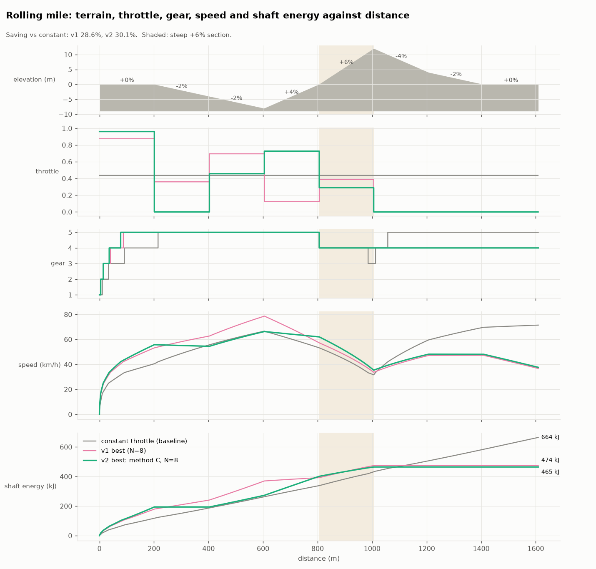
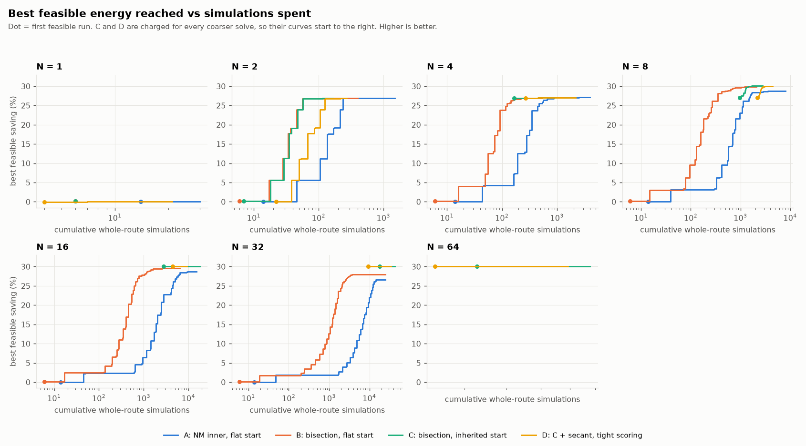

# Fiesta optimisation, brief v2: fewer simulations, finer control, honest savings

This answers [brief v2](docs/briefs/brief-v2.md):
* Can a better numerical method find a time-matched driving strategy with fewer whole-journey simulations?
* Does spending the saved computation on finer throttle control buy a meaningful energy saving?
* How much of the saving depends on how fast the car crosses the line?

> **Reconstruction on substitute inputs.** The simulator and the reference case were copied, read-only, from v1 (git tag `v1.0.0`) into `fiesta/` and `reference/`. Every copied file's SHA-256 is in [`reference/COPIED_FROM.json`](reference/COPIED_FROM.json).
>
> The car is the calibrated Fiesta 1.25 Duratec 82 PS: 0–100 km/h in 13.3 s and 168 km/h, matching Ford. The route is the rolling mile, 120 ± 0.1 s, with a 0.1 s step. Replaying the v1 reference case reproduces its arrival time, shaft energy, finishing speed and gear-change locations exactly.

## Setup and commands (Windows, PowerShell)

```powershell
cd fiesta-improved
py -m venv .venv
.\.venv\Scripts\Activate.ps1
pip install -r requirements.txt

python -m pytest -q            # 19 tests, ~5 s
python run.py quick            # ~15 s: parity, inner solvers, A/B/C/D to 4 sections  -> results/v2/quick/
python run.py full             # ~5 min on 12 cores: the whole brief                   -> results/v2/full/
python run.py report           # rebuild figures + REPORT.md from saved results (no re-simulation)
```

**Compared with v1:** see [COMPARISON.md](COMPARISON.md) (v1 results are kept in `results/v1/`; v1 code is at tag `v1.0.0`).

**Results:** [`results/v2/full/REPORT.md`](results/v2/full/REPORT.md) has every table and figure. The CSVs sit beside it: `ladders.csv`, `inner_comparison.csv`, `retimed_finalists.csv`, `multistart.csv`, `finish_speed.csv`, `time_step.csv` and `reference_replay.csv`. Inputs are in [`config/vehicle_route.json`](config/vehicle_route.json) (the vehicle, unchanged from v1) and [`config/experiment.json`](config/experiment.json) (budgets and solver settings).




## Compact results (rolling mile; baseline: constant throttle 0.437, 664.4 kJ, finish 19.85 m/s)

| Method | N | Energy (kJ) | Saving | Residual (s) | Finish (m/s) | Calls (cumulative) | Wall (s) |
|---|---|---|---|---|---|---|---|
| A: Nelder–Mead inner, flat start (historical) | 8 | 473.1 | 28.8% | +0.09 | 10.22 | 8 000 (budget) | 25 |
| B: bisection inner, flat start | 8 | 466.3 | 29.8% | +0.09 | 10.52 | 2 080 | 7 |
| **C: bisection, inherited coarse profile** | **8** | **464.6** | **30.1%** | +0.07 | 10.45 | 2 797 | 6 |
| A | 16 | 473.4 | 28.8% | +0.10 | 11.14 | 15 000 (budget) | 44 |
| B | 16 | 467.9 | 29.6% | +0.09 | 10.65 | 6 353 | 20 |
| C | 16 | 464.6 | 30.1% (no gain over 8) | +0.07 | 10.45 | 17 797 | 48 |
| A | 32 | 487.8 | 26.6% | −0.02 | 11.86 | 25 000 (budget) | 69 |
| B | 32 | 479.0 | 27.9% | +0.09 | 11.16 | 25 000 (budget) | 69 |
| C | 32 / 64 | 464.6 | 30.1% (no gain) | +0.07 | 10.45 | 42 797 / 77 797 | 70 / 93 |
| D (extra): C + secant splits + 0.02 s scoring | 32 | 464.8 | 30.05% | +0.08 | 10.59 | 34 210 | 71 |
| Matched finish (±0.2 m/s of baseline) | 8 | 643.7 | **3.1%** | +0.03 | 19.66 | 1 545 | – |
| Matched finish | 16 | 656.7 | 1.2% | +0.08 | 19.65 | 3 133 | – |

The full table, with every N, first-feasible call, feasible shapes and shifts, is in REPORT.md.

## Conclusions

**1. Bisection is a clear win.**
* **On 43 identical shapes:** it time-matched a shape in a median of **12 whole-route simulations, against 32** for scalar Nelder–Mead. It also succeeded more often: 36/43 against 30/43.
* **Inside the full search (B vs A at N = 8):** B reached 29.8% using 2,080 simulations; A reached 28.8% after spending its full 8,000.
* **First feasible run:** after 6 simulations instead of 14.
* **What it costs:** nothing, as long as the solver checks the *actual* simulated residual. Arrival time is not monotone in throttle scale: gear-policy changes make it jump by several seconds, sometimes clean over the ±0.1 s band (figure 3). The bisection reports such jumps and moves on. A synthetic-jump test confirms that neither solver claims a false success.

**2. Reusing the coarse solution makes the result reliable.**
* **The headline:** method C found the best profile overall, 30.07% at N = 8.
* **Start sensitivity:** across six documented starting simplexes at N = 8, C stayed between **29.7% and 30.1%**. The flat-start methods ranged from 22.1% to 30.0% (A) and 20.8% to 30.1% (B).
* **What it costs:** C is charged for its coarse solves, yet reached that point at 2,797 cumulative simulations.

**3. Going beyond 16 sections bought nothing measurable.**
* **C:** refined to 16, 32 and 64 sections by replaying the inherited profile; each replay was checked to give an identical drive. Another 15,000, 25,000 and 35,000 simulations found **no lower-energy feasible profile**.
* **D:** gained 0.15 kJ (0.02 points) at 32 sections.
* **Flat-start methods get worse at 32**, because the search space grows faster than the budget: A falls to 26.6%, B to 27.9%.
* **Why more resolution doesn't help:** the useful control freedom here is "push early, push on the approach to the hill, coast over the crest to the line", and 8 sections of 201 m already express it. The terrain itself only has 8 segments.

**4. Most of the "saving" is finishing slower.**
* **What the car carries over the line:** the baseline crosses at 19.85 m/s (½mv² = 208 kJ); the best profile crosses at 10.45 m/s (58 kJ).
* **Matched finishing speed:** when the optimised car must finish within 0.2 m/s of the baseline (a new experimental choice), the saving falls from **30.1% to 3.1%** (N = 8, seeded with the constant profile). The 16-section run reached only 1.2% within its budget.
* **The 34% recalled from Doug's university project is not a like-for-like comparison:** about nine-tenths of the free-finish saving is kinetic energy not carried over the line.

**5. Finer physics steps preserve the saving but break the timing.**
* **The constant baseline** stays in the window at 0.05 s and 0.025 s physics steps, with the controller still updating every 0.1 s.
* **Both optimised profiles drift out of the window** at the finer steps (v1 best by up to +0.70 s, v2 best by up to +0.35 s), because one gear change moves.
* **Re-timed (labelled):** the v2 profile costs 466.8–467.4 kJ, so the saving stays at about 29.8%.
* **The finalists' ranking holds:** re-timed to a common tighter residual, C < D < B < A at N ≥ 8.

**6. The upshift margin prevents gear hunting.** On a +7% climb at 0.70 throttle there is 1 shift with the margin and 377 shifts (362 reversals within 2 s) without it (figure 8).

## What changed from v1, and why

| Area | v1 | v2 |
|---|---|---|
| **Inner time solver** | 1-D Nelder–Mead on \|r(k)\| | Bounded bracketing and bisection, starting from the last successful scale. Unfinished runs count as late, the bracket nearest the nominal scale is tried first, jumps are detected and logged, same-sign endpoints are subdivided, and a budget is declared. An optional safeguarded secant split is available. |
| **Resolution** | Every N starts flat | Profiles are inherited by splitting each section into two identical children, replayed to confirm an identical drive, then improved. Tried at 32 and 64. |
| **Accounting** | Outer-evaluation caps | Every whole-route simulation is counted, against a declared per-resolution budget. A cache keyed on the applied throttle vector and a configuration hash uses the same policy for every method. C and D are charged for their coarse solves. |
| **Outer search hygiene** | – | Shape space had flat directions: scaling q, or making entries negative (clipped to zero throttle), gives identical applied throttles. Nelder–Mead could drift along them on free cache hits. A small quadratic term removes them without changing which applied profile wins, plus a shape-evaluation cap. |
| **Simulator** | Gear forecast every physics step | The controller update period is separate from the physics step (fixed at 0.1 s with a 1.0 s forecast), which enables the time-step study. Per-step allocations were removed in the gear chooser. Results are bit-identical at 0.1 s. |
| **Speed** | Serial | Methods, multistarts and finish-speed runs use separate processes. The full brief runs in about 5 minutes (v1's sweep took about 25). |
| **Tests** | 26 (v1) | 19 new, listed below. |

The 19 new tests cover:
* reference parity;
* the hand-calculated 40 kJ shaft work;
* split-section equivalence;
* the ideal locked drivetrain (shaft power = F·v), and that a lower rpm alone saves no work at the same force and speed;
* a bracketed target, an unreachable target and an unfinished low-throttle run;
* a synthetic gear jump that skips the time band;
* the cache key and budget enforcement;
* C's inherited replay;
* the controller update period;
* the reversal counter;
* the performance calibration.

## Caveats

* **All inputs are substitutes.** The terrain, torque curve and controller rules are not recovered originals.
* **Most searches stopped on a budget or cap, not on convergence.** The budgets are declared in `config/experiment.json`; most runs show "budget-limited: yes" in the report.
* **The ±0.1 s window adds about ±0.4 kJ of noise** to any single energy figure. Treat differences under about 1 kJ between methods at the same N as ties, unless the re-timed table agrees.
