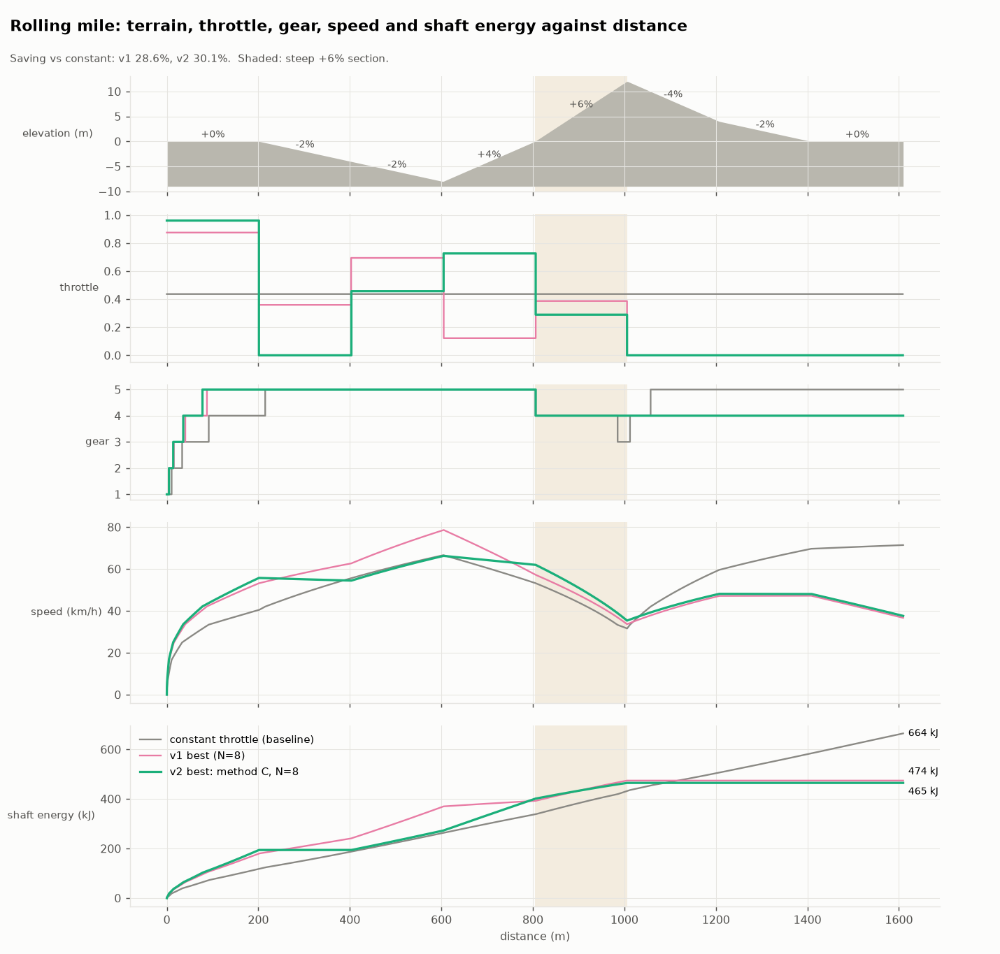
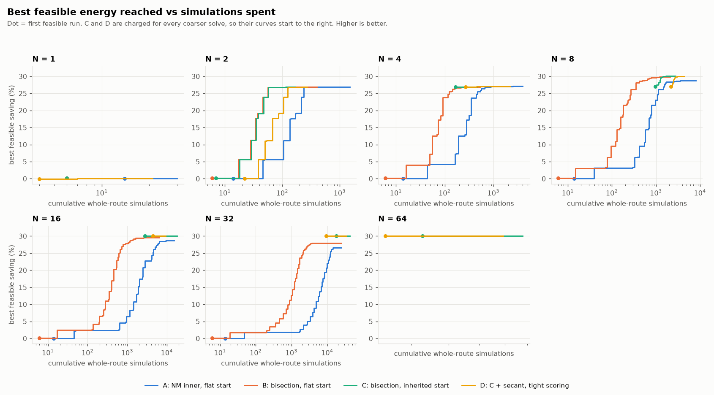
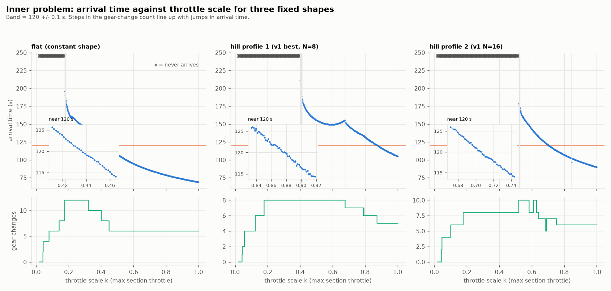
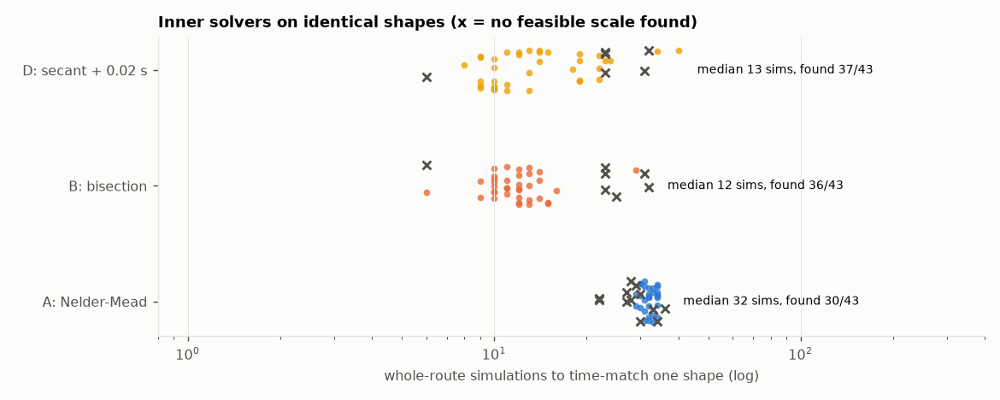
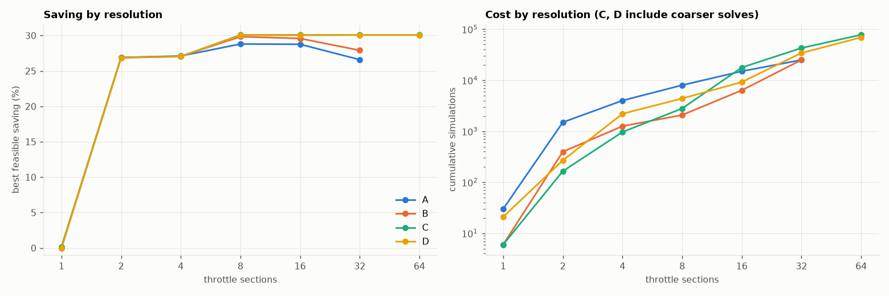
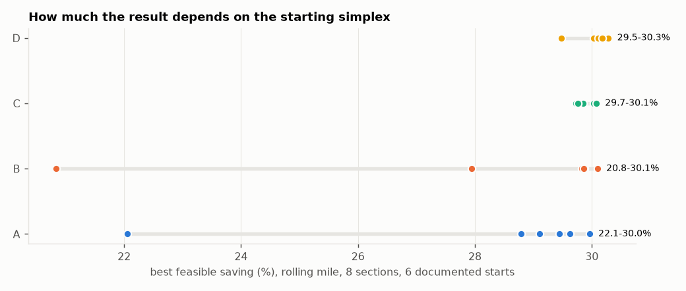
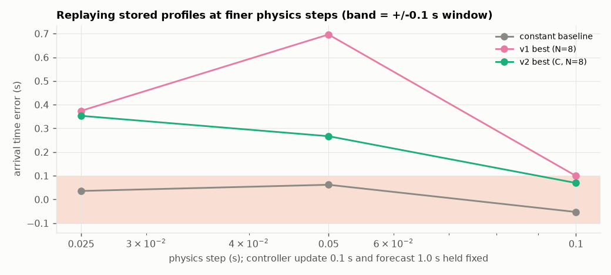
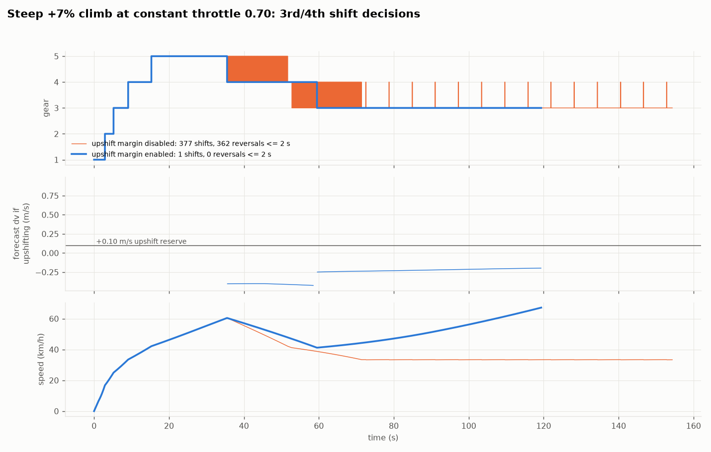

# Results report (full)

Reconstruction on substitute inputs (v1 reference case, calibrated Fiesta 1.25 82 PS). Rolling mile, 120 +/- 0.1 s, free finishing speed unless stated.

Constant-throttle baseline: 0.4367 throttle, 664.4 kJ, 119.947 s, finish 19.85 m/s (1/2 m v^2 = 207.8 kJ).

## Main comparison

| method | N | energy kJ | saving % | residual s | finish m/s | 1/2mv^2 kJ | shifts | calls (cum.) | first feasible at | feasible shapes | wall s | budget-limited |
|---|---|---|---|---|---|---|---|---|---|---|---|---|
| A | 1 | 664.43 | 0.00 | -0.05 | 19.85 | 207.78 | 8 | 30 | 14 | 36 | 0.09 | no |
| B | 1 | 663.52 | 0.14 | 0.08 | 19.84 | 207.71 | 8 | 6 | 6 | 36 | 0.02 | no |
| C | 1 | 663.52 | 0.14 | 0.08 | 19.84 | 207.71 | 8 | 6 | 6 | 36 | 0.02 | no |
| D | 1 | 664.39 | 0.01 | -0.06 | 19.86 | 208.04 | 8 | 21 | 4 | 36 | 0.06 | no |
| A | 2 | 485.80 | 26.88 | 0.05 | 10.25 | 55.40 | 7 | 1500 | 14 | 114 | 4.23 | yes |
| B | 2 | 485.84 | 26.88 | 0.10 | 10.23 | 55.20 | 7 | 397 | 6 | 1499 | 1.20 | yes |
| C | 2 | 485.91 | 26.87 | 0.02 | 10.21 | 55.04 | 5 | 165 | 7 | 1499 | 0.49 | yes |
| D | 2 | 486.05 | 26.85 | 0.04 | 10.20 | 54.87 | 5 | 269 | 22 | 1499 | 0.74 | yes |
| A | 4 | 484.36 | 27.10 | 0.04 | 9.93 | 51.99 | 6 | 4000 | 14 | 115 | 12.03 | yes |
| B | 4 | 484.65 | 27.06 | 0.10 | 9.79 | 50.61 | 6 | 1258 | 6 | 3996 | 4.16 | yes |
| C | 4 | 484.78 | 27.04 | 0.08 | 9.89 | 51.57 | 9 | 966 | 166 | 3999 | 2.51 | yes |
| D | 4 | 484.94 | 27.01 | 0.06 | 9.81 | 50.73 | 6 | 2203 | 270 | 3998 | 6.29 | yes |
| A | 8 | 473.13 | 28.79 | 0.09 | 10.22 | 55.07 | 5 | 8000 | 14 | 230 | 25.08 | yes |
| B | 8 | 466.28 | 29.82 | 0.09 | 10.52 | 58.41 | 5 | 2080 | 6 | 8000 | 6.96 | yes |
| C | 8 | 464.63 | 30.07 | 0.07 | 10.45 | 57.60 | 5 | 2797 | 967 | 7990 | 6.13 | yes |
| D | 8 | 464.93 | 30.03 | 0.03 | 10.62 | 59.53 | 5 | 4390 | 2204 | 7985 | 7.31 | yes |
| A | 16 | 473.38 | 28.75 | 0.10 | 11.14 | 65.46 | 5 | 15000 | 14 | 436 | 44.23 | yes |
| B | 16 | 467.92 | 29.58 | 0.09 | 10.65 | 59.79 | 7 | 6353 | 6 | 14981 | 19.84 | yes |
| C | 16 | 464.63 | 30.07 | 0.07 | 10.45 | 57.60 | 5 | 17797 | 2798 | 13815 | 47.83 | yes |
| D | 16 | 464.93 | 30.03 | 0.03 | 10.62 | 59.53 | 5 | 9210 | 4391 | 14995 | 15.06 | yes |
| A | 32 | 487.80 | 26.58 | -0.02 | 11.86 | 74.19 | 6 | 25000 | 14 | 765 | 68.57 | yes |
| B | 32 | 479.04 | 27.90 | 0.09 | 11.16 | 65.68 | 7 | 25000 | 6 | 1051 | 69.49 | yes |
| C | 32 | 464.63 | 30.07 | 0.07 | 10.45 | 57.60 | 5 | 42797 | 17798 | 690 | 70.26 | yes |
| D | 32 | 464.77 | 30.05 | 0.08 | 10.59 | 59.17 | 7 | 34210 | 9211 | 20813 | 70.60 | yes |
| C | 64 | 464.63 | 30.07 | 0.07 | 10.45 | 57.60 | 5 | 77797 | 42798 | 752 | 93.39 | yes |
| D | 64 | 464.77 | 30.05 | 0.08 | 10.59 | 59.17 | 7 | 69210 | 34211 | 1863 | 92.85 | yes |

## Inner solvers on identical shapes

| solver | shapes | found | median_sims | mean_sims | max_sims |
|---|---|---|---|---|---|
| A: Nelder-Mead | 43 | 30 | 32.0 | 31.2 | 36 |
| B: bisection | 43 | 36 | 12.0 | 14.0 | 32 |
| D: secant + 0.02 s | 43 | 37 | 13.0 | 16.2 | 40 |

| shape | solver | found | sims | residual_s | energy_kJ | message |
|---|---|---|---|---|---|---|
| flat (constant shape) | A: Nelder-Mead | yes | 30 | -0.05 | 665.45 | Optimization terminated successfully. |
| flat (constant shape) | B: bisection | yes | 6 | 0.08 | 663.52 | hit by bisect |
| flat (constant shape) | D: secant + 0.02 s | yes | 14 | 0.02 | 664.68 | in window, tighter target not reached (r(k) jumps over the window at 1 place(s)) |
| hill profile 1 (v1 best, N=8) | A: Nelder-Mead | yes | 31 | -0.02 | 476.54 | Maximum number of function evaluations has been exceeded. |
| hill profile 1 (v1 best, N=8) | B: bisection | yes | 16 | -0.10 | 475.67 | hit by bisect |
| hill profile 1 (v1 best, N=8) | D: secant + 0.02 s | yes | 11 | 0.00 | 475.25 | hit by interpolate |
| hill profile 2 (v1 N=16) | A: Nelder-Mead | yes | 32 | 0.00 | 475.75 | Maximum number of function evaluations has been exceeded. |
| hill profile 2 (v1 N=16) | B: bisection | yes | 12 | -0.01 | 475.45 | hit by bisect |
| hill profile 2 (v1 N=16) | D: secant + 0.02 s | yes | 10 | -0.01 | 477.16 | hit by interpolate |

## Resolution

### Finalists re-timed to |r| <= 0.01 s

| n_sections | method | energy_kJ | residual_s | retimed_energy_kJ | retimed_residual_s | rank_original | rank_retimed |
|---|---|---|---|---|---|---|---|
| 1 | A | 664.43 | -0.05 | 664.68 | 0.02 | 4 | 2 |
| 1 | B | 663.52 | 0.08 | 664.68 | 0.02 | 1 | 3 |
| 1 | C | 663.52 | 0.08 | 664.68 | 0.02 | 2 | 4 |
| 1 | D | 664.39 | -0.06 | 664.68 | 0.02 | 3 | 1 |
| 2 | A | 485.80 | 0.05 | 486.59 | -0.03 | 1 | 2 |
| 2 | B | 485.84 | 0.10 | 486.60 | -0.03 | 2 | 3 |
| 2 | C | 485.91 | 0.02 | 486.26 | 0.01 | 3 | 1 |
| 2 | D | 486.05 | 0.04 | 487.39 | 0.02 | 4 | 4 |
| 4 | A | 484.36 | 0.04 | 484.36 | 0.04 | 1 | 1 |
| 4 | B | 484.65 | 0.10 | 486.04 | -0.07 | 2 | 4 |
| 4 | C | 484.78 | 0.08 | 485.36 | 0.01 | 3 | 3 |
| 4 | D | 484.94 | 0.06 | 485.22 | 0.01 | 4 | 2 |
| 8 | A | 473.13 | 0.09 | 475.52 | -0.01 | 4 | 4 |
| 8 | B | 466.28 | 0.09 | 467.96 | 0.01 | 3 | 3 |
| 8 | C | 464.63 | 0.07 | 464.91 | 0.05 | 1 | 1 |
| 8 | D | 464.93 | 0.03 | 466.53 | 0.02 | 2 | 2 |
| 16 | A | 473.38 | 0.10 | 475.23 | 0.05 | 4 | 4 |
| 16 | B | 467.92 | 0.09 | 469.72 | 0.03 | 3 | 3 |
| 16 | C | 464.63 | 0.07 | 464.91 | 0.05 | 1 | 1 |
| 16 | D | 464.93 | 0.03 | 466.53 | 0.02 | 2 | 2 |
| 32 | A | 487.80 | -0.02 | 487.69 | -0.01 | 4 | 4 |
| 32 | B | 479.04 | 0.09 | 480.27 | -0.01 | 3 | 3 |
| 32 | C | 464.63 | 0.07 | 464.91 | 0.05 | 1 | 1 |
| 32 | D | 464.77 | 0.08 | 465.55 | 0.04 | 2 | 2 |
| 64 | C | 464.63 | 0.07 | 464.91 | 0.05 | 1 | 1 |
| 64 | D | 464.77 | 0.08 | 465.55 | 0.04 | 2 | 2 |

## Multistart (rolling, N = 8)

| method | perturbation | energy_kJ | saving_percent | residual_s | sims | stop |
|---|---|---|---|---|---|---|
| A | 0.25 | 473.13 | 28.79 | 0.09 | 8000 | budget exhausted |
| A | -0.25 | 465.36 | 29.96 | -0.03 | 8000 | budget exhausted |
| A | 0.1 | 467.63 | 29.62 | 0.07 | 8000 | budget exhausted |
| A | 0.5 | 468.77 | 29.45 | 0.06 | 8000 | budget exhausted |
| A | random:1 | 517.88 | 22.06 | 0.10 | 8000 | budget exhausted |
| A | random:2 | 471.08 | 29.10 | -0.03 | 8000 | budget exhausted |
| B | 0.25 | 466.28 | 29.82 | 0.09 | 2080 | shape-evaluation cap |
| B | -0.25 | 465.97 | 29.87 | 0.04 | 1773 | shape-evaluation cap |
| B | 0.1 | 478.78 | 27.94 | 0.10 | 1886 | shape-evaluation cap |
| B | 0.5 | 464.46 | 30.10 | 0.01 | 1927 | shape-evaluation cap |
| B | random:1 | 525.98 | 20.84 | 0.03 | 2688 | shape-evaluation cap |
| B | random:2 | 465.98 | 29.87 | 0.00 | 2149 | shape-evaluation cap |
| C | 0.25 | 464.63 | 30.07 | 0.07 | 1831 | shape-evaluation cap |
| C | -0.25 | 464.90 | 30.03 | -0.00 | 1717 | shape-evaluation cap |
| C | 0.1 | 466.12 | 29.85 | -0.02 | 1674 | shape-evaluation cap |
| C | 0.5 | 464.61 | 30.07 | 0.03 | 1704 | shape-evaluation cap |
| C | random:1 | 466.95 | 29.72 | 0.08 | 1867 | shape-evaluation cap |
| C | random:2 | 466.68 | 29.76 | 0.09 | 1809 | shape-evaluation cap |
| D | 0.25 | 464.93 | 30.03 | 0.03 | 2187 | shape-evaluation cap |
| D | -0.25 | 463.32 | 30.27 | 0.06 | 6957 | shape-evaluation cap |
| D | 0.1 | 464.39 | 30.11 | 0.04 | 2896 | shape-evaluation cap |
| D | 0.5 | 463.22 | 30.28 | 0.05 | 8000 | budget exhausted |
| D | random:1 | 463.93 | 30.18 | -0.10 | 4474 | shape-evaluation cap |
| D | random:2 | 468.55 | 29.48 | 0.07 | 3567 | shape-evaluation cap |

## Matched finishing speed (within 0.2 m/s of the constant car)

| n_sections | baseline_kJ | baseline_finish_m_s | energy_kJ | finish_m_s | residual_s | saving_percent | kept_baseline | sims | stop |
|---|---|---|---|---|---|---|---|---|---|
| 8 | 664.43 | 19.85 | 643.72 | 19.66 | 0.03 | 3.12 | no | 1545 | shape-evaluation cap |
| 16 | 664.43 | 19.85 | 656.68 | 19.65 | 0.08 | 1.17 | no | 3133 | shape-evaluation cap |

## Time-step sensitivity (controller 0.1 s, forecast 1.0 s fixed)

| profile | dt_s | time_error_s | in_window | energy_kJ | shifts | same_shift_sequence | max_shift_shift_m | retimed_energy_kJ | retimed_residual_s |
|---|---|---|---|---|---|---|---|---|---|
| constant baseline | 0.100 | -0.053 | yes | 664.429 | 8 | yes | 0.000 | - | - |
| constant baseline | 0.050 | 0.062 | yes | 664.817 | 8 | yes | 1.131 | - | - |
| constant baseline | 0.025 | 0.036 | yes | 665.164 | 8 | yes | 1.401 | - | - |
| v1 best (N=8) | 0.100 | 0.099 | yes | 474.097 | 5 | yes | 0.000 | - | - |
| v1 best (N=8) | 0.050 | 0.696 | no | 474.185 | 6 | no | - | 476.465 | 0.021 |
| v1 best (N=8) | 0.025 | 0.374 | no | 475.100 | 5 | yes | 0.544 | 476.635 | 0.067 |
| v2 best (C, N=8) | 0.100 | 0.070 | yes | 464.628 | 5 | yes | 0.000 | - | - |
| v2 best (C, N=8) | 0.050 | 0.267 | no | 465.386 | 5 | yes | 1.051 | 467.361 | -0.092 |
| v2 best (C, N=8) | 0.025 | 0.353 | no | 465.648 | 5 | yes | 1.391 | 466.835 | 0.081 |

## Gear hunting

| upshift margin | shifts_on_climb | rapid_reversals | time_s | energy_kJ |
|---|---|---|---|---|
| enabled | 1 | 0 | 119.35 | 1584.92 |
| disabled | 377 | 362 | 154.34 | 1352.09 |

## Provenance

* Reference parity (time, energy, finish speed, gear-change locations): **OK** (`reference_replay.csv`).
* Inputs copied from `../fiesta-reconstruction (read-only)`, commit `71810ce04e8dfd0b969d33814f97b0524022623a`; SHA-256 of every copied file in `reference/COPIED_FROM.json`.
* Software: python 3.14.7, platform Windows-11-10.0.26200-SP0, numpy 2.5.2, scipy 1.18.1, matplotlib 3.11.2, numba 0.68.1.
* Total wall time 295 s.
