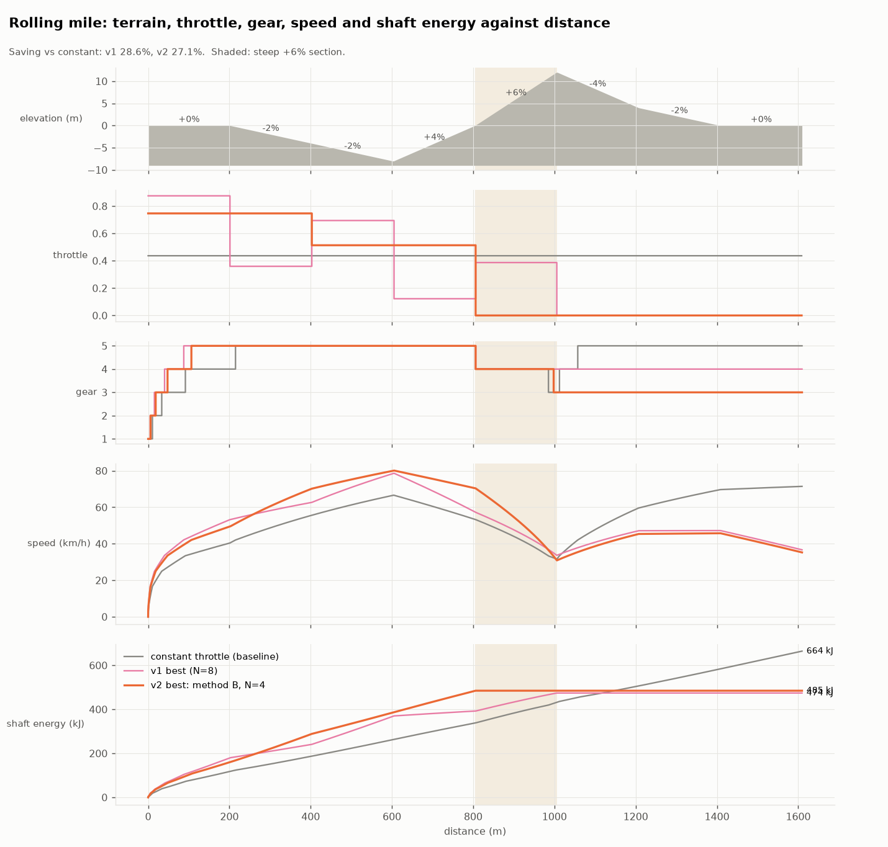
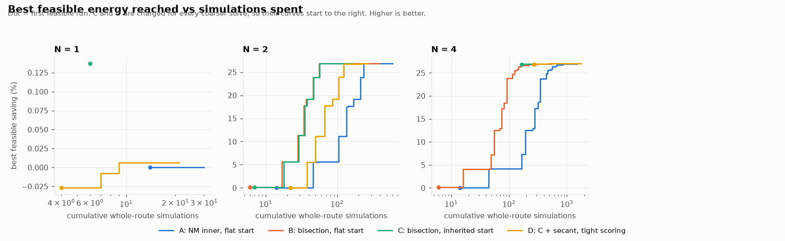
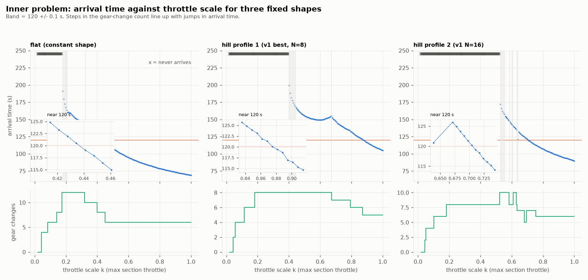
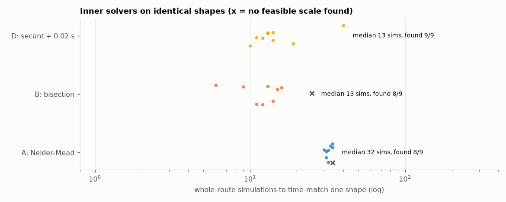
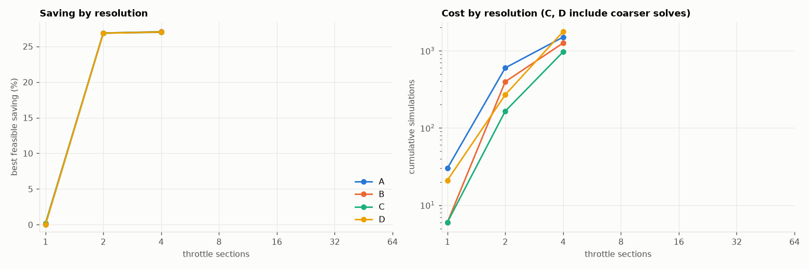
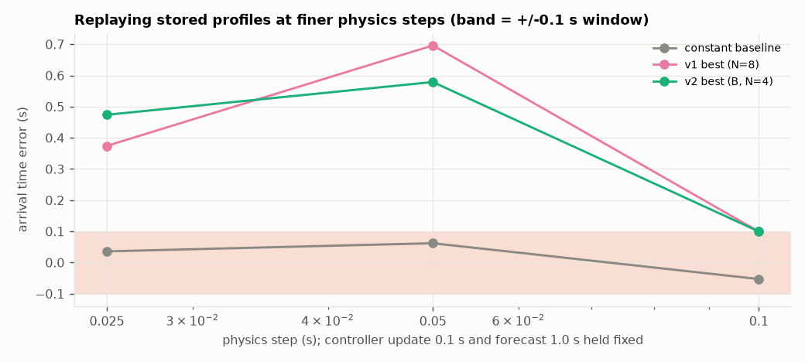
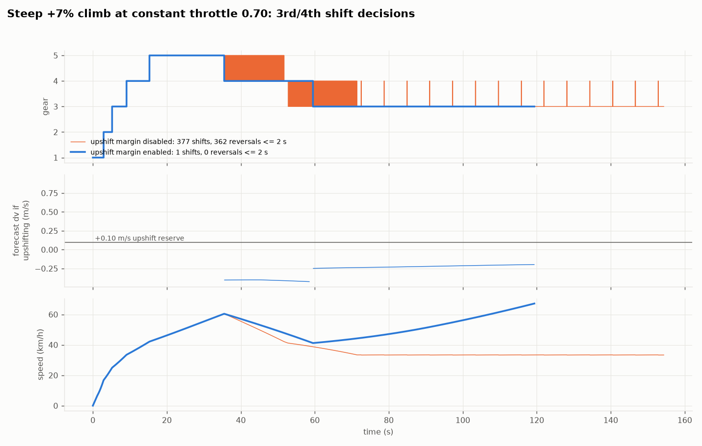

# Results report (quick)

Reconstruction on substitute inputs (v1 reference case, calibrated Fiesta 1.25 82 PS). Rolling mile, 120 +/- 0.1 s, free finishing speed unless stated.

Constant-throttle baseline: 0.4367 throttle, 664.4 kJ, 119.947 s, finish 19.85 m/s (1/2 m v^2 = 207.8 kJ).

## Main comparison

| method | N | energy kJ | saving % | residual s | finish m/s | 1/2mv^2 kJ | shifts | calls (cum.) | first feasible at | feasible shapes | wall s | budget-limited |
|---|---|---|---|---|---|---|---|---|---|---|---|---|
| A | 1 | 664.43 | 0.00 | -0.05 | 19.85 | 207.78 | 8 | 30 | 14 | 36 | 0.15 | no |
| B | 1 | 663.52 | 0.14 | 0.08 | 19.84 | 207.71 | 8 | 6 | 6 | 36 | 0.03 | no |
| C | 1 | 663.52 | 0.14 | 0.08 | 19.84 | 207.71 | 8 | 6 | 6 | 36 | 0.02 | no |
| D | 1 | 664.39 | 0.01 | -0.06 | 19.86 | 208.04 | 8 | 21 | 4 | 36 | 0.06 | no |
| A | 2 | 485.92 | 26.87 | 0.02 | 10.21 | 55.04 | 5 | 600 | 14 | 72 | 1.80 | yes |
| B | 2 | 485.84 | 26.88 | 0.10 | 10.23 | 55.20 | 7 | 397 | 6 | 599 | 1.25 | yes |
| C | 2 | 485.91 | 26.87 | 0.02 | 10.21 | 55.04 | 5 | 165 | 7 | 599 | 0.49 | yes |
| D | 2 | 486.05 | 26.85 | 0.04 | 10.20 | 54.87 | 5 | 269 | 22 | 599 | 0.77 | yes |
| A | 4 | 485.16 | 26.98 | 0.02 | 10.06 | 53.35 | 6 | 1500 | 14 | 43 | 4.42 | yes |
| B | 4 | 484.65 | 27.06 | 0.10 | 9.79 | 50.61 | 6 | 1258 | 6 | 1496 | 4.15 | yes |
| C | 4 | 484.78 | 27.04 | 0.08 | 9.89 | 51.57 | 9 | 966 | 166 | 1499 | 2.58 | yes |
| D | 4 | 484.94 | 27.01 | 0.06 | 9.81 | 50.73 | 6 | 1769 | 270 | 106 | 4.81 | yes |

## Inner solvers on identical shapes

| solver | shapes | found | median_sims | mean_sims | max_sims |
|---|---|---|---|---|---|
| A: Nelder-Mead | 9 | 8 | 32.0 | 32.3 | 34 |
| B: bisection | 9 | 8 | 13.0 | 13.4 | 25 |
| D: secant + 0.02 s | 9 | 9 | 13.0 | 16.2 | 40 |

| shape | solver | found | sims | residual_s | energy_kJ | message |
|---|---|---|---|---|---|---|
| flat (constant shape) | A: Nelder-Mead | yes | 30 | -0.05 | 665.45 | Optimization terminated successfully. |
| flat (constant shape) | B: bisection | yes | 6 | 0.08 | 663.52 | hit by bisect |
| flat (constant shape) | D: secant + 0.02 s | yes | 14 | 0.02 | 664.68 | in window, tighter target not reached (r(k) jumps over the window at 1 place(s)) |
| hill profile 1 (v1 best, N=8) | A: Nelder-Mead | yes | 31 | -0.02 | 476.54 | Maximum number of function evaluations has been exceeded. |
| hill profile 1 (v1 best, N=8) | B: bisection | yes | 16 | -0.10 | 475.67 | hit by bisect |
| hill profile 1 (v1 best, N=8) | D: secant + 0.02 s | yes | 11 | 0.00 | 475.25 | hit by interpolate |
| hill profile 2 (v1 N=16) | A: Nelder-Mead | yes | 32 | 0.00 | 475.75 | Maximum number of function evaluations has been exceeded. |
| hill profile 2 (v1 N=16) | B: bisection | yes | 12 | -0.01 | 475.45 | hit by bisect |
| hill profile 2 (v1 N=16) | D: secant + 0.02 s | yes | 10 | -0.01 | 477.16 | hit by interpolate |

## Resolution

### Finalists re-timed to |r| <= 0.01 s

| n_sections | method | energy_kJ | residual_s | retimed_energy_kJ | retimed_residual_s | rank_original | rank_retimed |
|---|---|---|---|---|---|---|---|
| 1 | A | 664.43 | -0.05 | 664.68 | 0.02 | 4 | 2 |
| 1 | B | 663.52 | 0.08 | 664.68 | 0.02 | 1 | 3 |
| 1 | C | 663.52 | 0.08 | 664.68 | 0.02 | 2 | 4 |
| 1 | D | 664.39 | -0.06 | 664.68 | 0.02 | 3 | 1 |
| 2 | A | 485.92 | 0.02 | 486.69 | -0.01 | 3 | 3 |
| 2 | B | 485.84 | 0.10 | 486.60 | -0.03 | 1 | 2 |
| 2 | C | 485.91 | 0.02 | 486.26 | 0.01 | 2 | 1 |
| 2 | D | 486.05 | 0.04 | 487.39 | 0.02 | 4 | 4 |
| 4 | A | 485.16 | 0.02 | 485.26 | -0.00 | 4 | 2 |
| 4 | B | 484.65 | 0.10 | 486.04 | -0.07 | 1 | 4 |
| 4 | C | 484.78 | 0.08 | 485.36 | 0.01 | 2 | 3 |
| 4 | D | 484.94 | 0.06 | 485.22 | 0.01 | 3 | 1 |

## Time-step sensitivity (controller 0.1 s, forecast 1.0 s fixed)

| profile | dt_s | time_error_s | in_window | energy_kJ | shifts | same_shift_sequence | max_shift_shift_m | retimed_energy_kJ | retimed_residual_s |
|---|---|---|---|---|---|---|---|---|---|
| constant baseline | 0.100 | -0.053 | yes | 664.429 | 8 | yes | 0.000 | - | - |
| constant baseline | 0.050 | 0.062 | yes | 664.817 | 8 | yes | 1.131 | - | - |
| constant baseline | 0.025 | 0.036 | yes | 665.164 | 8 | yes | 1.401 | - | - |
| v1 best (N=8) | 0.100 | 0.099 | yes | 474.097 | 5 | yes | 0.000 | - | - |
| v1 best (N=8) | 0.050 | 0.696 | no | 474.185 | 6 | no | - | 476.465 | 0.021 |
| v1 best (N=8) | 0.025 | 0.374 | no | 475.100 | 5 | yes | 0.544 | 476.635 | 0.067 |
| v2 best (B, N=4) | 0.100 | 0.100 | yes | 484.654 | 6 | yes | 0.000 | - | - |
| v2 best (B, N=4) | 0.050 | 0.579 | no | 484.630 | 6 | yes | 1.687 | 486.741 | 0.001 |
| v2 best (B, N=4) | 0.025 | 0.474 | no | 485.134 | 6 | yes | 1.480 | 487.352 | -0.076 |

## Gear hunting

| upshift margin | shifts_on_climb | rapid_reversals | time_s | energy_kJ |
|---|---|---|---|---|
| enabled | 1 | 0 | 119.35 | 1584.92 |
| disabled | 377 | 362 | 154.34 | 1352.09 |

## Provenance

* Reference parity (time, energy, finish speed, gear-change locations): **OK** (`reference_replay.csv`).
* Inputs copied from `../fiesta-reconstruction (read-only)`, commit `71810ce04e8dfd0b969d33814f97b0524022623a`; SHA-256 of every copied file in `reference/COPIED_FROM.json`.
* Software: python 3.14.7, platform Windows-11-10.0.26200-SP0, numpy 2.5.2, scipy 1.18.1, matplotlib 3.11.2, numba 0.68.1.
* Total wall time 12 s.
